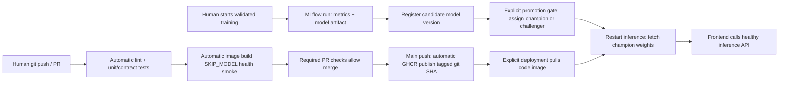

# Lab 5 — CI/CD, contracts and promotion

## Answers

1. Tests that fetch a real model can fail because the tracking server is offline, the registry alias is absent, credentials/network fail, or the model is incompatible. Those external failures do not prove an API-code regression. Fake-model tests avoid these dependencies.
2. The fake verifies image decoding, normalization/batch shape, model invocation, class selection, softmax confidence and JSON. It does not establish real-model accuracy, real-registry connectivity or model quality.
3. The cross-split content-hash check catches a copied image. Tests deliberately insert such a duplicate in a temporary dataset and then corrupt it, proving both checks reject bad data. Leakage silently inflates evaluation accuracy; a corrupted file is usually visible through a decoding error.
4. Validate immediately after `dvc pull` on a data-accessible runner, and immediately before training. This training script invokes all five checks. Isolated CI uses a small generated temporary dataset to test contract enforcement without pretending the runner has the real data.
5. `needs: test` causes smoke to be skipped if test fails. Without it, smoke can run independently and waste a build on broken code.
6. Workflow timing and run URLs are in verification.md. Subsequent test installs can use setup-uv's dependency cache; image publication uses BuildKit's GitHub cache. Do not equate a failed quick run with a successful cached run.
7. SHA tags identify exact code. With mutable latest, a machine pulling before a push and one pulling after it can run different layers under the same tag. Models remain independently selected by champion.
8. The publish job grants only contents:read and packages:write. A broad token in a compromised step could alter repository code, releases or settings; least privilege limits damage.
9. main requires a PR and the test/smoke statuses. PR #1 deliberately failed a test: test failed, smoke was skipped and mergeable_state was blocked. The failure was then repaired. See branch_protection.json and the PR history for evidence. Teammates get centrally enforced checks rather than relying on promises about laptop tests.
10. experiments.json records each candidate's accuracy, champion accuracy, evaluation size, 2*SE, required threshold and decision. Candidates use the same dataset hash/test size. Only a candidate meeting `accuracy >= champion + 2*sqrt(p*(1-p)/n)` moves champion; otherwise it becomes challenger. Version tags preserve the decision.
11. Run promotion on a self-hosted runner on the training network, or use a hosted MLflow registry and a runner with access to evaluation data. A post-training local orchestration step is another option. Cloud runners cannot reach this laptop's localhost registry.
12. The pipeline is shown below. The Git SHA selects code; champion selects model. Promotion and rollout are explicit actions, not falsely described as automatic deployment.

## Measured promotion outcomes

Champion version 1 scored 73.1752% on 1,096 evaluation images. The two-standard-error margin was 2.6765 percentage points, so promotion required at least 75.8517%.

- Version 2 (run aa6c4b98f9f645588badc6fd1d4ccb1c): accuracy 12.8650%; decision `set_as_challenger`.
- Version 3 (run 922730140356497eb64f4cf134c96b8a): accuracy 73.1752%; decision `set_as_challenger`.

Both failed to exceed the required threshold. Champion remains version 1; challenger now points to version 3. The actual mini-data duplicate experiment exited 1 as expected and its temporary copy was removed; see duplicate_check.txt.
